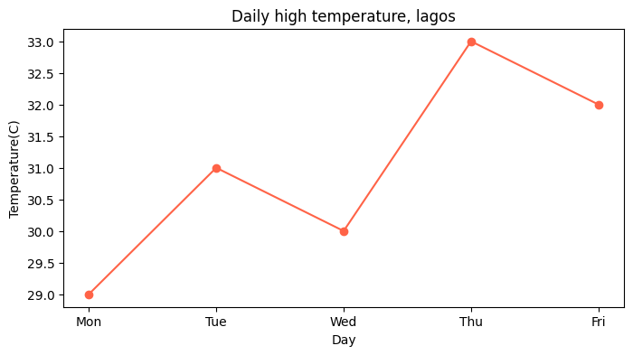
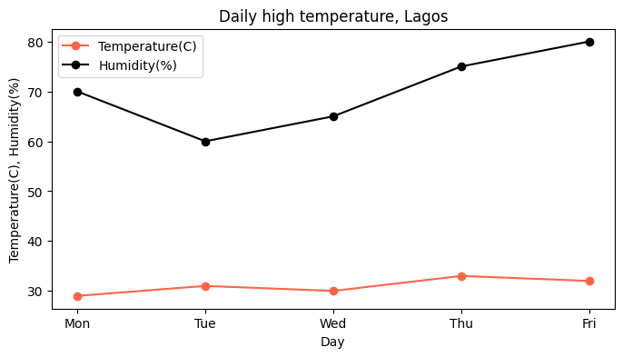

# Lagos Weather Trend Visualization Using Python

A beginner-friendly Python data visualization project using Matplotlib to explore and present daily temperature and humidity trends in Lagos.

## Table of Contents

- [Project Overview](#project-overview)
- [Introduction](#introduction)
- [Project Objectives](#project-objectives)
- [Dataset Overview](#dataset-overview)
- [Data Visualization](#data-visualization)
- [Key Insights](#key-insights)
- [Tools and Technologies](#tools-and-technologies)
- [Repository Structure](#repository-structure)
- [How to Run the Project](#how-to-run-the-project)
- [Conclusion](#conclusion)
- [Author](#author)

## Project Overview

This project demonstrates the use of Python's Matplotlib library to create line charts for visualizing daily weather information in Lagos.

The visualizations focus on two important weather indicators:

- Daily temperature (°C)
- Daily humidity (%)

The project includes an individual temperature trend chart and a combined temperature and humidity visualization.

## Introduction

Data visualization is an important aspect of data analysis because it helps transform numerical information into meaningful visual representations.

In this project, I used Python and Matplotlib to visualize five days of temperature and humidity observations in Lagos.

The aim was to understand how line charts can be used to communicate trends and patterns in data.

## Project Objectives

1. Understand the fundamentals of Matplotlib.
2. Create line charts using Python.
3. Visualize temperature trends across five days.
4. Compare temperature and humidity patterns.
5. Practise chart customization, including titles, labels, markers, legends, and axes.

## Dataset Overview

The project uses a small sample dataset containing five days of weather observations.

| Day | Temperature (°C) | Humidity (%) |
|---|---:|---:|
| Monday | 29 | 70 |
| Tuesday | 31 | 60 |
| Wednesday | 30 | 65 |
| Thursday | 33 | 75 |
| Friday | 32 | 80 |

**Note:** The dataset is illustrative and is not sourced from an official weather station.

## Data Visualization

### 1. Daily Temperature Trend

This visualization displays the daily high temperature recorded across five days.



### 2. Temperature and Humidity Comparison

This visualization compares daily temperature and humidity using two vertical axes to accommodate their different measurement units.



## Key Insights

From the sample dataset, the following observations were made:

- Thursday recorded the highest temperature at 33°C.
- Monday recorded the lowest temperature at 29°C.
- Tuesday recorded the lowest humidity at 60%.
- Friday recorded the highest humidity at 80%.
- Temperature increased from Monday to Tuesday before fluctuating during the remaining days.
- Humidity generally increased from Tuesday to Friday.

## Tools and Technologies

- **Python:** Programming language.
- **Matplotlib:** Data visualization library.
- **Google Colab:** Development environment.

## Repository Structure

```text
lagos-weather-visualization/
│
├── README.md
├── python/
│   └── weather_visualization.py
│
└── images/
    ├── temperature_chart.png
    └── temperature_humidity_chart.png
```

## How to Run the Project

1. Clone or download this repository.
2. Open the Python script in Google Colab or Jupyter Notebook.
3. Install Matplotlib if it is not already installed:

   `pip install matplotlib`

4. Run the Python script to generate the visualizations.

## Conclusion

This project provided practical experience in using Matplotlib to create and customize line charts.

It strengthened my understanding of data visualization concepts, including plotting multiple variables, labeling axes, customizing chart appearances, and communicating insights from data.

## Author

**Hassan Rosheedat Temitayo**

Data Analyst | Python | Excel | SQL | Power BI

[E-mail](rosheedathassan7@gmail.com) | [LinkedIn](www.linkedin.com/in/hassan-rosheedat-570a6340a)

Interested in transforming raw data into meaningful insights through data analysis and visualization.
